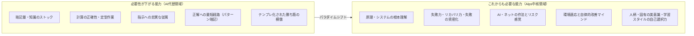

# 🏔️ Alps 設計思想：AI・エージェントネイティブ時代における学びの再定義

本ドキュメントは、**🏔️ Alps（Active Learning Personal Supporter）** の設計原点となった問題意識と、生成AI・AIエージェントが前提となった社会における「能力のパラダイムシフト」を整理したものです。

---

## 1. 「禁止」でも「代行」でもない第3の道

現在、生成AIと学習をめぐる議論は、大きく二つの立場に二極化しがちです。

1. **生成AI全面禁止論・紙の暗記回帰論**
   「読解力や思考力が落ちる」「テストの得点が下がる」として、学習環境からAIやデジタルツールを遠ざけようとする立場。
2. **執筆代行・タイパ至上主義**
   レポートや思考プロセスそのものをAIに丸投げし、手っ取り早く整った文章や結論を得ようとする立場。

しかし、この二項対立には共通の盲点があります。前者は「旧来の暗記テストや定型文の読解スコア」という前時代の評価指標（物差し）が未来も普遍であるという前提に立っており、後者は人間自身の思考が空洞化するリスクを見落としています。

必要なのは、教育・学習の場からAIを締め出すことではなく、**「AIに思考を明け渡さず（飲まれず）、AIと対等に向き合い、自分の思考を深める鏡として使いこなす作法」** を身につけることです。

真の解は「AIの禁止」でも「AIによる代行（ゴーストライター化）」でもなく、**AIを学習者自身の思考・経験・現場感覚を極限まで引き出す対等な対話パートナーとして協働すること** にあります。これを具体的な対話サイクルと基本ルールに落とし込んだものが `Alps` です。

---

## 2. 能力のパラダイムシフト

AIエージェントが知識の検索・整理・定型処理を高速に担う社会では、人間に求められる能力の比重が大きく変化します。

### 必要性が下がっていく能力
- **知識ストックや暗記のスピード**: 知識を脳内に保持して素早く取り出す作業や、パターン認識で定型問題を解く処理はAIが代替します。
- **指示待ちの忠実な作業**: 与えられた手順をそのまま実行するだけの業務は、AIエージェントに置き換わっていきます。

### これからも必要な能力
- **原理の理解**: 単なる暗記ではなく、「なぜその構造になっているのか」というメンタルモデルを自分の言葉で掴む力。
- **失敗力と失敗資産の蓄積**: テンプレート通りの成功談よりも、試行錯誤のなかでどこで躓き、どう立て直したかという固有の記録が資産になります。
- **AI利用のリスク感覚と作法**: ハルシネーションやセキュリティリスクを見抜き、健全な境界線を保ちながら協働する力。
- **学習スタイルの自己選択力**: 用意された画一的な勉強法に自分を無理に合わせるのではなく、自分が最も納得しやすいテンポ・比喩・手段を自ら選んで学びを進める力。

---

## 3. 思想から Alps の設計・基本ルールへの接続

| AI時代の要請 | Alps の設計・基本ルール | 具体的な振る舞い |
| :--- | :--- | :--- |
| **型に縛られないスタイルの尊重** | 自律型パーソナル設計 | 画一的なカリキュラムに人を合わせるのではなく、学習者の納得感・知的好奇心に基づき、進度や寄り道の有無を本人が選ぶ。 |
| **暗記ではなく「原理の納得」** | アナロジーの引き出し | AIが安易な例え話を押し付けず、学習者自身の過去の経験や専門分野の感覚と結びつけて理解を引き出す。 |
| **失敗資産の蓄積** | 暗黙前提の結晶化 | 対話で生まれた違和感、失敗、軌道修正、合意事項を流さず、その場で学習ノートへ明文化し、共有学習資産として保存する。 |
| **AI利用のリスクと作法** | ケチャップ（ケチデフォルトキャップ）🍅 | 過剰なリソース消費や意図せぬ挙動を防ぐため、AIと対等に上限や境界を確認しながら協働する。 |
| **指示従属からの脱却** | ソクラテス式アウトプット | AIに答えを任せきりにせず、狭い面積の問いかけを通じて学習者本人の言葉と思考を引き出し、構造化して記録する。 |
